# 三角债智能梳理与净额轧差系统

> 自建本体模型 + 线上大模型 AI · 本地规则推理与最优清偿求解
>
> 版本 V1.0 · 按《三角债智能梳理与净额轧差系统技术方案》实现

一套可本地闭环运行的债务清理软件：把合同、欠条、对账函中的债权债务整理成债务网络，
由 OWL/SWRL 本体判定每笔债务能否抵销，按主体计算净头寸，并用精确求解器给出
**金额全部结清、交易笔数最少**的清偿清单，可导出方案报告与多方抵销协议草稿。

---

## 一、快速启动

环境要求：Windows / macOS / Linux，Python 3.10+，本地浏览器。

```powershell
cd debt-netting
python run.py --seed
```

启动后浏览器自动打开 `http://127.0.0.1:8765`（若该端口被其他程序占用会自动切换，
桌面快捷方式会读取 `data/runtime.url` 打开实际地址）。`--seed` 首次启动会载入示例数据；
不加 `--seed` 则以空台账启动。Windows 用户也可以直接双击 `start.bat`，
脚本会自动选择本机可用的 Python 运行时。若命令行 `python` 指向未安装依赖的解释器，
请改用装了 `requirements.txt` 的 Python 3.10+，或使用 `start.bat`。

常用参数：

| 参数 | 说明 |
| --- | --- |
| `--port 8765` | 指定端口；被占用时自动向后寻找空闲端口 |
| `--no-browser` | 不自动打开浏览器 |
| `--seed` | 台账为空时载入示例数据 |
| `--reset` | 清空本地业务数据后启动（不可撤销） |
| `--log` | 运行日志追加写入 `data/server.log`（桌面快捷方式使用） |

### 桌面快捷方式

已在本机桌面创建 **“三角债智能轧差系统”** 快捷方式，双击即可启动并打开浏览器：

- 已在运行时不会重复启动进程，只打开现有页面；
- 8765 等端口被其他本地程序占用时，会自动切换到空闲端口，快捷方式从 `data/runtime.url` 读取实际地址；
- 运行日志写在 `data/server.log`；
- 停止服务：系统设置 → 本地数据 → **停止本地服务**；
- 移动项目目录后，可用 `tools/create_shortcut.ps1` 重新创建桌面快捷方式。

依赖：核心功能仅需 `python-docx`、`openpyxl`（导出 Word / Excel）。
OCR、PDF 解析为可选能力，见 `requirements.txt`。

也可以双击 `start.bat` 启动。

---


打开网站后先看到**工作记录列表**：选择一条历史工作记录进入，或新建一条。每条工作记录有独立的债务、材料、图谱和核算。

## 二、功能与方案章节对照

| 技术方案要求 | 本实现 | 位置 |
| --- | --- | --- |
| 自建本体：实体类、属性、关系、SWRL 抵销规则 | `ontology/debt_ontology.owl`（Protégé 可直接打开） | `ontology/` |
| 本地推理：逐笔判定允许抵销、分组、命中规则与法条 | SWRL 子集解析器 + 本地前向推理，保留完整推理链 | `app/ontology.py` |
| 债务图谱：主体为节点、债务为有向加权边、环路与枢纽检索 | SQLite 图谱仓储 + 环枚举 / Tarjan SCC / 枢纽识别，前端 SVG 债务网络（小规模环形布局、大规模力导向） | `app/graph.py`、`web/app.js` |
| 净头寸：应收 − 应付、净债权人/净债务人/归零出局 | 整数分计算，避免浮点误差 | `app/netting.py` |
| 最小交易笔数轧差求解 | 先剥离等额对冲，再以“最大零和划分”精确搜索；超时回退启发式并如实标注 | `app/netting.py` |
| 材料导入、OCR、线上要素抽取、脱敏、异常兜底 | 文件文本提取（docx/txt/图片 OCR 可选）→ LLM 抽取 → 本地归一化与复核 | `app/extract.py`、`app/llm.py` |
| 批量导入债务 | CSV/TSV/JSON 逐行导入，自动建主体，逐行报错；内置 28 笔复杂案例 | `app/service.py`、`web/app.js` |
| 工作记录（Case） | 顶层数据单位；每条记录独立 SQLite 数据库，债务/材料/图谱/核算/审计全部隔离；首页先选记录 | `app/cases.py`、`app/service.py`、`web/app.js` |
| 核算记录 | 每次核算生成递增编号，保存债务快照与方案；可从列表回看、查看债务清单、删除 | `app/db.py`、`app/service.py`、`web/app.js` |
| 本地 Web 界面：录入、上传、图谱、方案、导出 | 零外部依赖单页应用，本地 HTTP 服务 | `app/server.py`、`web/` |
| 结果导出 | 债务台账 Excel、方案 Excel、方案报告 Word、多方抵销协议草稿 Word（可选 AI 解读） | `app/exports.py` |
| 审计留痕 | 数据变更、规则重载、抽取、轧差、导出、设置修改均入审计表 | `app/db.py`、`app/service.py` |
| 法律边界与风险提示 | 方案页、报告、协议均内置“非法定自动抵销、须签署协议并法务终审”提示；资金约束生成分期建议 | `web/app.js`、`app/exports.py` |

### 示例数据

载入示例后，普通债权分组即方案 6.5 的经典四主体闭环：

```
A 华远建设 → B 恒通建材  500 万
B 恒通建材 → C 中鑫物流  300 万
C 中鑫物流 → D 安泰设备  400 万
D 安泰设备 → A 华远建设  100 万
```

净头寸：A −400、B +200、C −100、D +300；求解结果：

| 序号 | 付款方 | 收款方 | 金额 |
| --- | --- | --- | --- |
| 1 | A 华远建设 | B 恒通建材 | 200 万 |
| 2 | A 华远建设 | D 安泰设备 | 200 万 |
| 3 | C 中鑫物流 | D 安泰设备 | 100 万 |

共 3 笔，达到 `M + N − 1 = 2 + 2 − 1 = 3` 的理论下界，收支校验通过。

示例台账还包含：争议债务、查封冻结债务、未到期债务、约定禁止抵销债务（均被规则阻断）、
抵押优先债权与职工工资债权（按顺位分组独立轧差）、一笔 AI 抽取待复核债务。

---

## 三、核心设计

### 3.1 本体与规则

`ontology/debt_ontology.owl` 是规则的单一可信来源，包含：

- 实体类：`LegalEntity`、`DebtObligation`、`Asset`、`SettlementPlan`、`PriorityClaim`、`IneligibleDebt`
- 对象属性：`hasDebtor`、`hasCreditor`、`guaranteedBy`、`settlesDebt`
- 数据属性：金额、本金、利息、到期日、争议、查封、禁止抵销、顺位分组、确认状态等
- SWRL 规则：R1 争议、R2 查封冻结、R3 未到期、R4 禁止抵销、R5 优先顺位隔离、
  R6 金额异常复核、R7 债权债务同体

本地引擎把每笔债务实例化为个体，计算派生属性（是否到期、是否优先、是否同体、金额是否为正），
再逐条评估 SWRL 规则，输出 `允许抵销 / 阻断 / 待复核` 与命中的规则、法条。新增业务约束时，
只需在 OWL 中追加规则，无需改动求解与前端模块；保存后点击“重新加载本体”即可生效。

> 说明：本实现内置一个针对本项目规则子集的 OWL/SWRL 解析与推理器（布尔属性原子、类原子、
> 变量），不依赖 Java 推理机，便于纯本地部署。规则的完整语义与 Protégé 中的结构保持一致。

### 3.2 最小交易笔数求解

设净债务人 `M` 个、净债权人 `N` 个，问题本质是带固定费用的运输问题。本实现利用如下结论：

> 参与主体按“零和子集”划分为尽可能多的 `G` 组后，最少交易笔数 = `N总 − G`。

- 一个零和组内，每笔交易至少使一个主体头寸归零，因此可用 `组内主体数 − 1` 笔结清；
- 任何清偿方案的支持边分解为若干平衡连通分量，边数不可能少于 `主体数 − 分量数`；
- 因此最大化零和划分数就是最小化交易笔数。

求解流程：

1. 先剥离金额完全对冲的两两配对（可证明不影响最优性）；
2. 参与主体数 ≤ 18 时，用带记忆化、上界剪枝和节点预算的精确搜索，搜索完成即**证明全局最优**；
3. 超时或规模更大时，退化为“等额配对 + 3/4 元零和子集”启发式，并在方案中标注“未证明最优”，
   不把启发式结果冒充最优。

金额全程以“分”为整数单位计算，导出与展示时再转元，避免浮点误差。

### 3.3 数据与隐私边界

- 主体、债务、材料、方案、审计全部保存在本地 `data/debt_netting.db`（SQLite）；
- 本体规则保存在 `ontology/`，可版本管理；
- 线上模型密钥保存在 `config/settings.json`（或环境变量 `DEBT_LLM_API_KEY`），不进入本体、图谱与审计；
- 上传线上模型前可开启脱敏：主体名称、统一社会信用代码、身份证号、手机号、银行账号替换为代号；
- 关闭“允许上传原始材料文本”后，抽取只能使用本地规则，不向线上发送任何文本；
- AI 抽取结果默认标记“待复核”，人工确认前不进入轧差池。

---

### 3.4 两种计算口径

系统提供两套口径，可在“运行净额轧差”时选择，或一次生成对比：

| 口径 | 入池范围 | 分组 | 用途 |
| --- | --- | --- | --- |
| **法律合规口径** | 仅已确认且通过本体规则的债务；排除争议、查封冻结、未到期、约定禁止抵销、待复核债务 | 普通、抵押、工资、税款等独立轧差 | 实际清偿安排、方案报告、抵销协议草稿 |
| **纯数学口径** | 全部未人工排除债务（含待复核），忽略争议、查封、到期、禁止抵销 | 全部债务合并为一个池 | 测算理论最少交易笔数、最大抵销空间 |

示例台账同一批 11 笔债务的两种结果：

| 指标 | 法律合规口径 | 纯数学口径 |
| --- | ---: | ---: |
| 纳入债务 | 6 笔 / 1,580 万 | 11 笔 / 1,770 万 |
| 未入池 | 5 笔 / 190 万 | 0 笔 |
| 清偿交易 | 5 笔 | 4 笔 |
| 支付总额 | 780 万 | 790 万 |

纯数学口径合并了优先顺位分组，且把争议、查封、未到期、禁止抵销与待复核债务一并纳入；因此**不能生成抵销协议，也不能作为实际清偿依据**，只用于测算。对比页会列出两种口径额外纳入的债务及法律口径排除原因。

接口：`POST /api/netting/run`（body `{"mode":"legal"|"pure"}`）、`POST /api/netting/compare`。

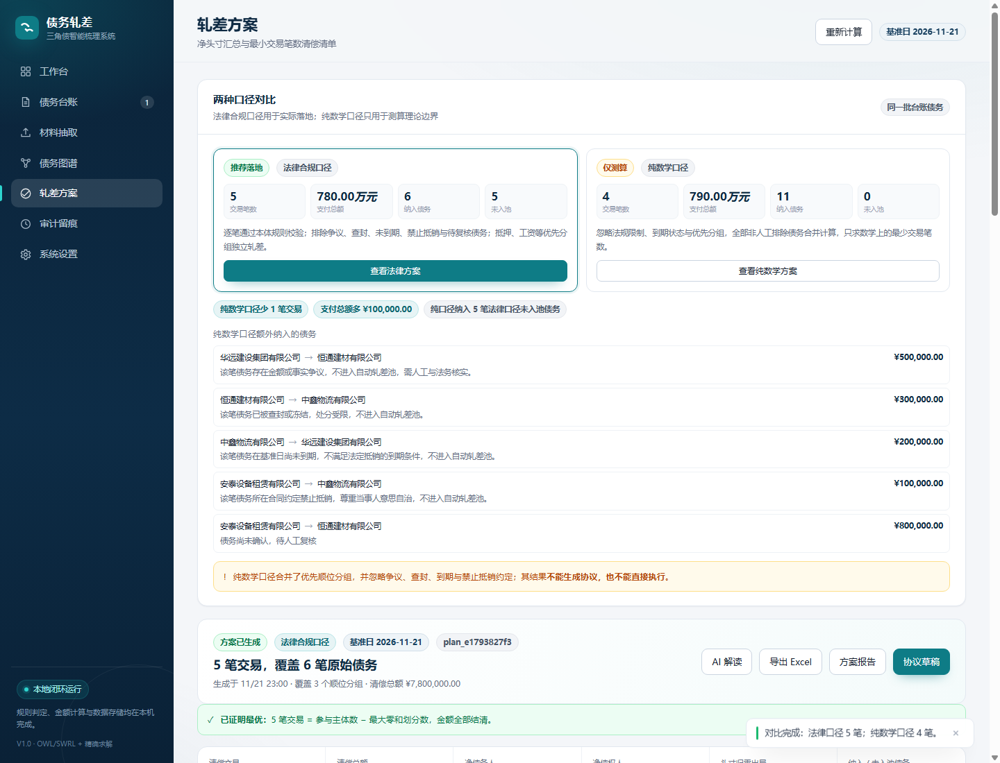

方案页默认先展示“大白话：谁给谁钱”，专业明细可展开：

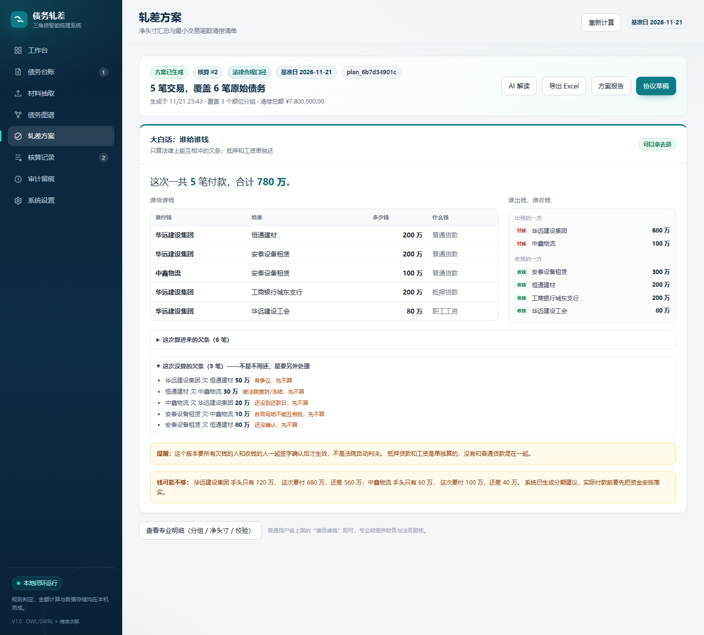

纯数学口径的大白话页面会明确提示“只是数学配对、不能执行”：

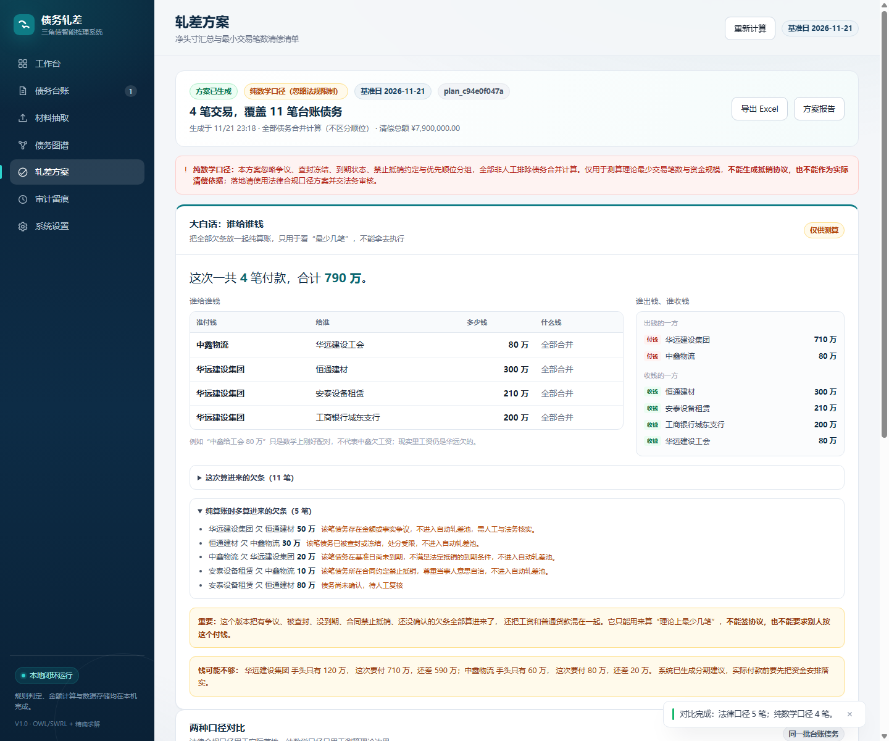

### 3.5 批量导入与复杂案例验证

台账页支持 **CSV / TSV / JSON 批量导入**（`POST /api/debts/import`），可识别“债务人、债权人、金额、到期日、争议、查封、禁止抵销、分组、备注、状态”等中英文表头；主体不存在时自动创建，逐行返回失败原因，单次最多 5000 行。

为验证通用性，使用公开的多人分摊案例 [Settle group debts in fewer payments](https://sleipner42.github.io/settle-group-debts-fewest-payments.html) 做了一次转换测试：原文为 5 人、7 笔共同支出、原始 28 笔两两还款。将每笔支出中“未付款人各欠付款人 1/5”转成 28 笔债务记录（金额按万元等比例放大），5 个主体为 A—E 公司。

- 原始债务：**28 笔**
- 算总账后：A 应收 360 万，B、E 不欠不收，C 欠 160 万，D 欠 200 万
- 最终付款：**2 笔，合计 360 万**
  - C 公司 → A 公司 160 万
  - D 公司 → A 公司 200 万
- 原始 28 笔关系聚合为 20 条有向边，图页对密集图自动隐藏金额标签，点击主体后显示相关边金额

复杂案例 CSV 在 [docs/examples/complex_28.csv](docs/examples/complex_28.csv)，可在“债务台账 → 批量导入 → 填入复杂示例”一键载入。

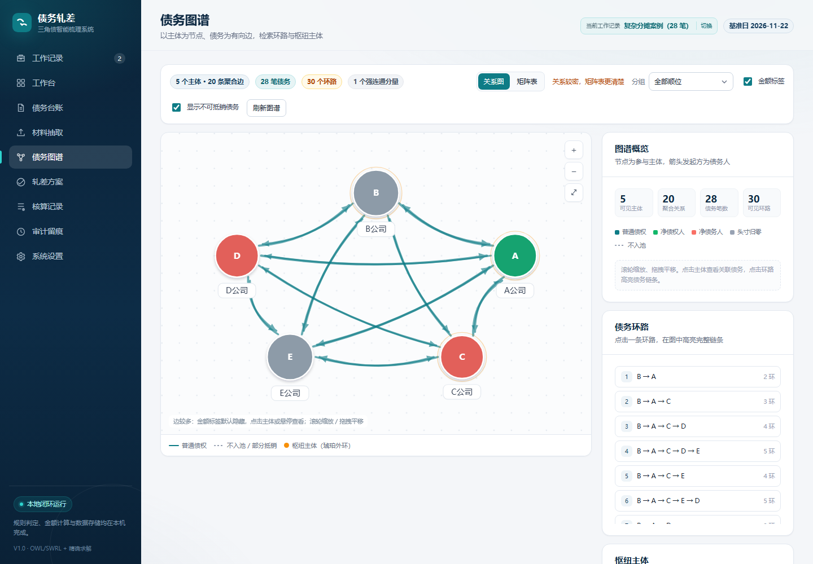

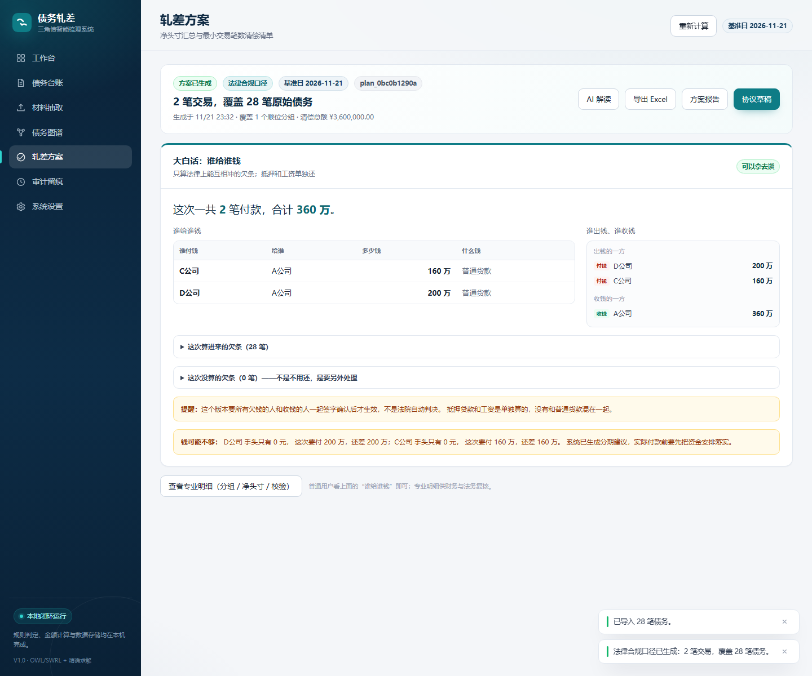

已知边界：系统按单一口径金额计算，不处理多币种混算；参与轧差主体数 ≤ 18 时精确证明最优，更多主体会回退启发式并标注；复杂图默认精简边标签，悬停/选中查看。

### 3.6 核算记录（编号列表）

进入某条工作记录后，“核算记录”只列这条工作记录内部的核算。每次运行净额轧差都会生成一条独立的“核算记录”，编号从 **#1** 开始持续递增，并按 `seq` 长期保留：

- 列表页展示编号、核算名称、生成时间、计算口径、债务总数、入池/未入池、付款笔数、付款总额；
- 点“查看”进入该次方案，点“清单”查看这次核算保存的完整债务快照（含每笔是否入池及原因）；
- 删除记录只删除该次快照，不影响债务台账；
- 债务台账后续修改或导入新数据，不会改变历史核算记录；
- 一次“两口径对比”会生成两条记录（纯数学口径、法律合规口径各一条），各自可回看。

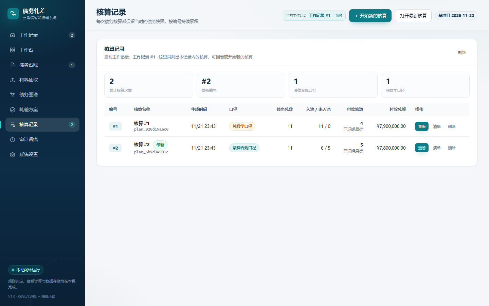

### 3.7 工作记录（顶层数据隔离）

顶层数据单位不是“当前台账”，而是**工作记录（Case）**：

- 打开网站先进入“工作记录”列表，看到历次工作记录，而不是直接进工作台；
- 每条工作记录拥有**独立 SQLite 数据库**：主体、债务、材料、图谱、核算方案、审计全部隔离；
- 选中某条工作记录后，侧边栏的“工作台、债务台账、材料抽取、债务图谱、轧差方案、核算记录、审计留痕”都只显示这条记录的数据；
- 工作台只显示当前选中的工作记录，不再混看所有历史数据；
- 新建工作记录可选空白，也可勾选“载入示例数据”（6 个主体、11 笔债务，并生成一次核算）；
- 顶部“当前工作记录”标签可随时切回列表。

当前示例有两条工作记录：

- **工作记录 #1**：11 笔债务、6 个主体、2 次核算；
- **工作记录 #2**：复杂的 28 笔分摊案例、5 个主体、1 次核算。

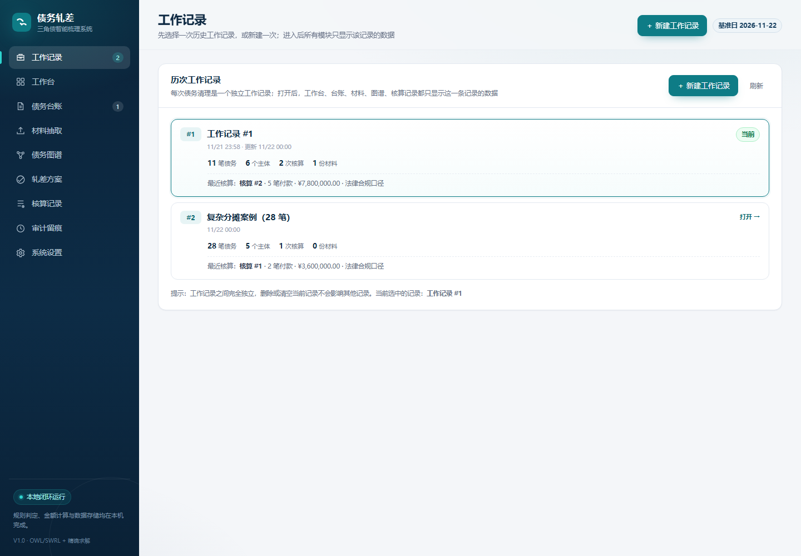

选中某条记录后，模块顶部会显示“当前工作记录 · … · 切换”，台账等数据随之切换：

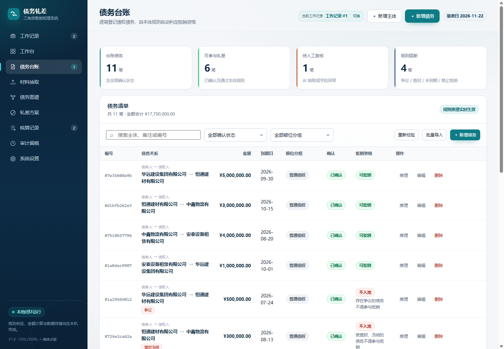

工作记录之间完全独立；设置页的“重置/清空”只影响当前工作记录。

## 四、界面

| 页面 | 作用 |
| --- | --- |
| 工作记录（首页） | 历次工作记录列表；选一条进入，或新建；进入后所有模块只显示该记录数据 |
| 工作台 | KPI、债务构成、最近方案、本体规则、最近操作 |
| 债务台账 | 搜索/筛选、录入编辑、逐笔查看规则推理链、确认/排除、主体管理 |
| 材料抽取 | 上传/粘贴材料 → 线上或本地抽取 → 逐条复核 → 导入；已存档材料可追溯 |
| 债务图谱 | 聚合有向债务网络、金额标签、环路/枢纽检索；支持顺位分组筛选、滚轮缩放、拖拽平移、点击主体或环路高亮 |
| 轧差方案 | 默认“大白话”展示谁给谁多少钱、谁出钱谁收钱、没解决的欠条；可展开净头寸、分组清单、校验等专业明细 |
| 审计留痕 | 全部操作与方案快照 |
| 系统设置 | 基准日、求解预算、隐私开关、LLM 配置、本体规则、数据重置 |

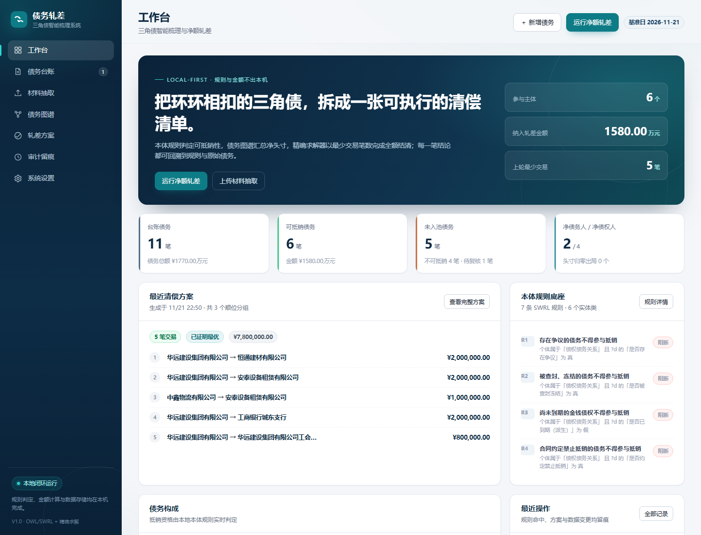

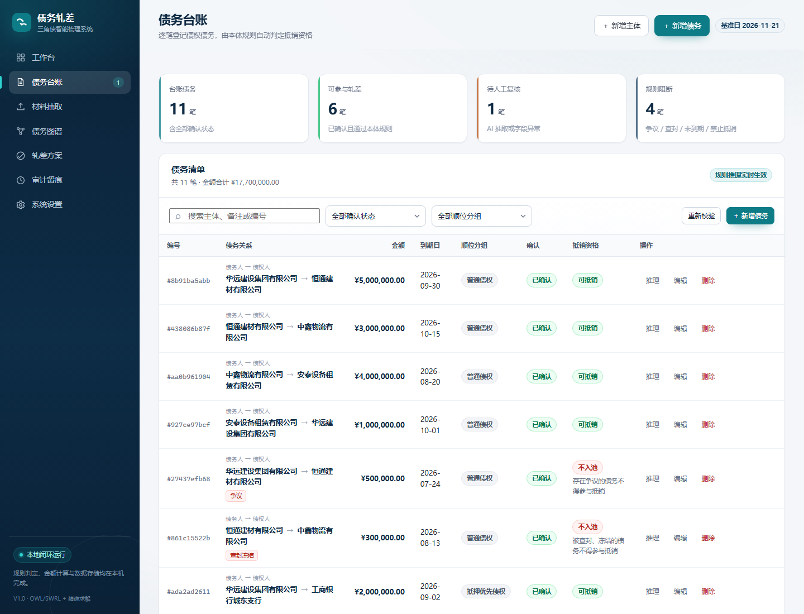

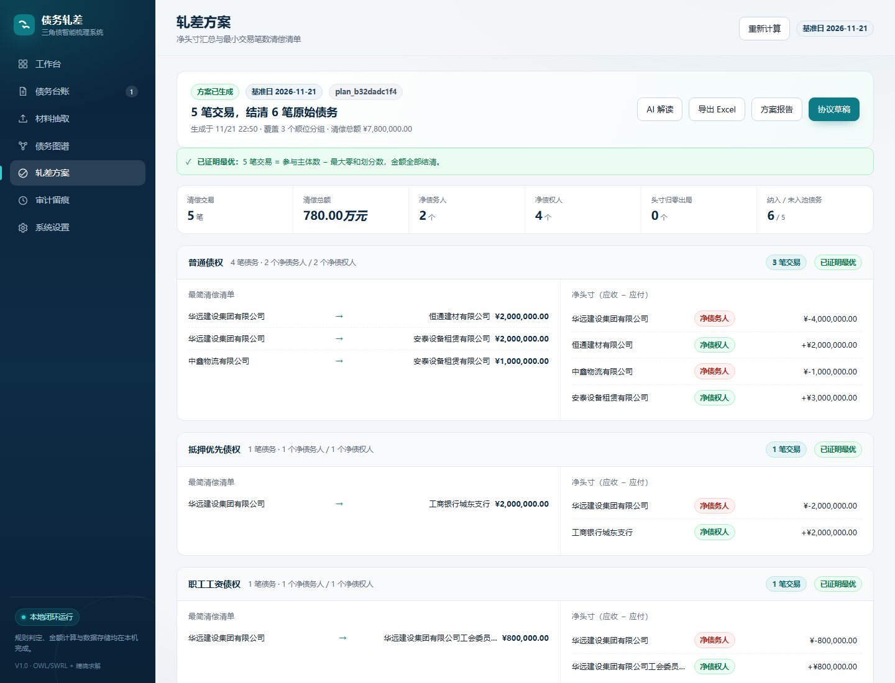

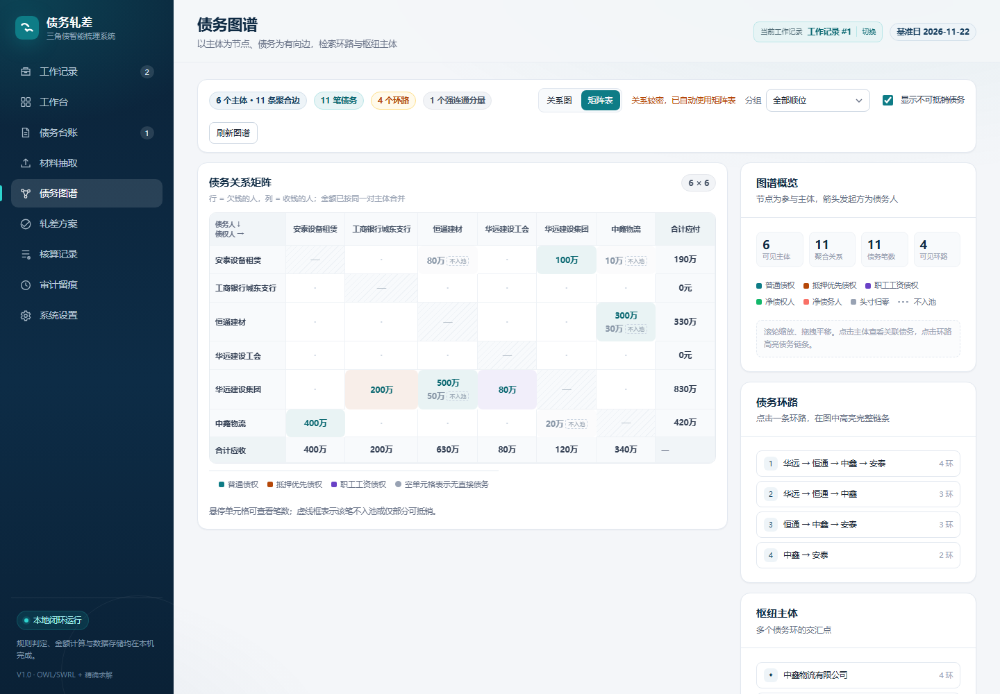

点击主体后自动高亮其债务关系，并在右侧展示关联债务：

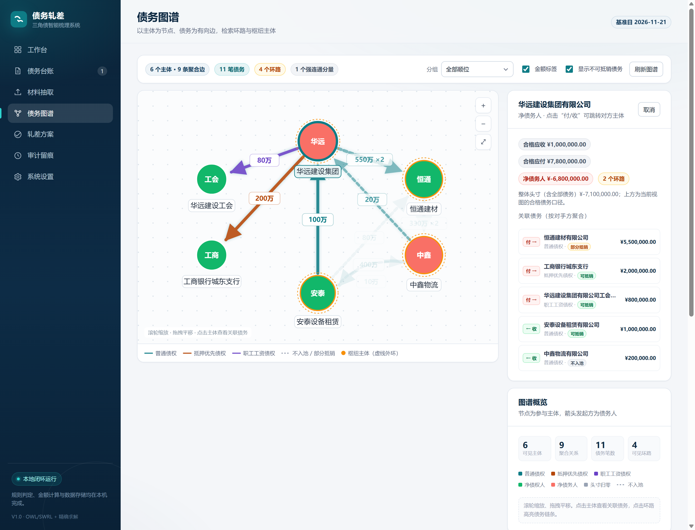

点击环路可高亮整条债务链条：

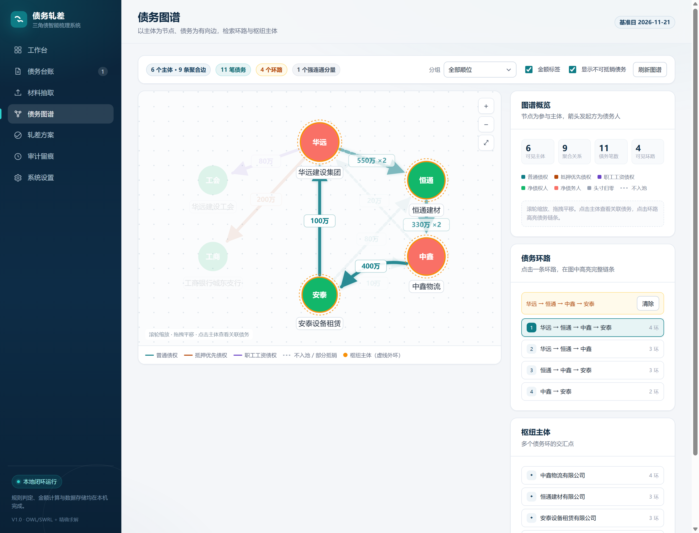

### 图谱阅读方式

- **箭头**由债务人指向债权人；同一对主体之间的多笔同向债务聚合为一条边，边上的金额为合计值，`×2` 表示聚合了两笔；
- **节点颜色**：绿色=净债权人、红色=净债务人、灰色=头寸归零；金色虚线外环=同时位于多个环路的枢纽主体；
- **边颜色**：普通债权青绿、抵押优先棕色、职工工资紫色；虚线表示含不入池债务，悬停可查看每笔明细与不入池原因；
- **操作**：滚轮缩放、拖拽平移、右上角按钮复位；点击主体高亮其债务关系并在右侧显示对头关联；点击环路高亮完整链条；
- **筛选**：可按债权顺位分组查看，也可隐藏不可抵销债务，只看进入轧差池的合格边。


- **密集关系**：聚合边超过 12 条时自动切换到“矩阵表”；行 = 债务人，列 = 债权人，单元格为同一对主体的合计金额，`×2` 表示聚合了两笔债务。

- **状态分线**：可抵销债务用实线，不可抵销债务用灰色虚线，分别成线（不再把两种状态合成一条边）；同一对主体之间即使既有可抵销又有不可抵销债务，也会分两条线显示。
- **标签避让**：关系线超过 12 条时默认只显示选中主体的金额标签，标签之间做碰撞避让；需要核对全部金额时切矩阵表。- **视图切换**：工具栏可在“关系图 / 矩阵表”之间切换；矩阵表适合核对精确金额，关系图适合看环路和风险传导。

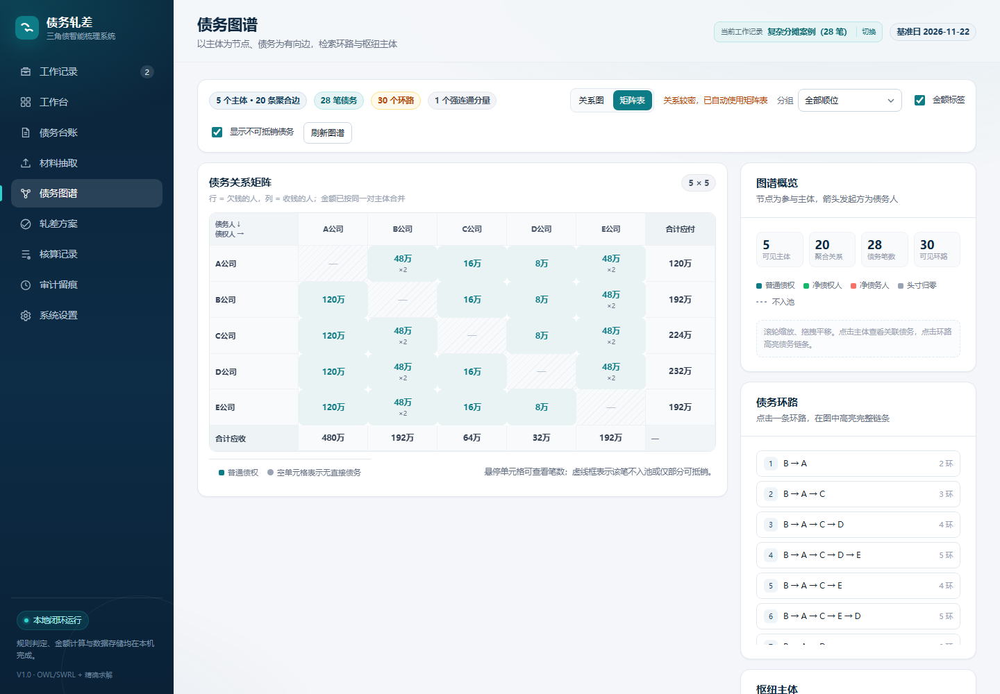

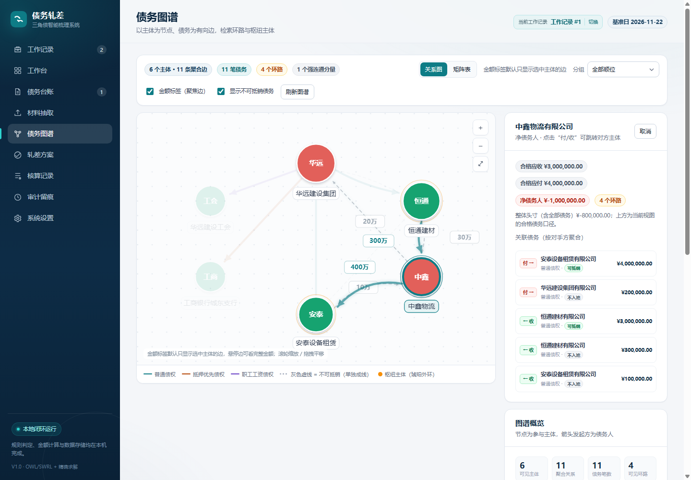


---

- **状态分线**：可抵销债务用实线，不可抵销债务用灰色虚线，分别成线（不再把两种状态合成一条边）；同一对主体之间即使既有可抵销又有不可抵销债务，也会分两条线显示。
- **标签避让**：关系线超过 12 条时默认只显示选中主体的金额标签，标签之间做碰撞避让；需要核对全部金额时切矩阵表。


## 五、项目结构

```
debt-netting/
├─ run.py                     启动入口
├─ start.bat                  Windows 一键启动（可见控制台）
├─ 启动债务轧差系统.vbs         桌面快捷方式启动器（无控制台，自动打开浏览器）
├─ assets/app.ico             应用图标
├─ app/
│  ├─ cases.py               工作记录注册表与独立数据库路由
│  ├─ config.py               配置与路径（密钥与业务数据分离）
│  ├─ db.py                   SQLite 持久层与审计
│  ├─ ontology.py             OWL/SWRL 解析与本地推理
│  ├─ netting.py              净头寸、最大零和划分、交易生成、分期建议
│  ├─ graph.py                环路、枢纽、强连通分量
│  ├─ extract.py              文本提取、脱敏、本地抽取、LLM 结果归一化
│  ├─ llm.py                  OpenAI 兼容接口客户端（DeepSeek/千问/文心）
│  ├─ exports.py              Excel / Word 导出
│  ├─ service.py              业务编排
│  └─ server.py               本地 HTTP API 与静态资源
├─ web/                       单页前端（无 CDN、无构建）
├─ ontology/debt_ontology.owl OWL + SWRL 规则资产
├─ tests/                     38 项单元与接口测试
├─ data/                      运行数据（数据库、材料、导出）
└─ config/                    本地配置
```

---

## 六、线上模型配置

在“系统设置 → 线上大模型”中填写，或直接编辑 `config/settings.json`：

```json
{
  "llm": {
    "enabled": true,
    "provider": "deepseek",
    "base_url": "https://api.deepseek.com/v1",
    "model": "deepseek-chat",
    "api_key": "<your-api-key>",
    "temperature": 0.1,
    "timeout": 60
  }
}
```

内置预设：

| 厂商 | 接口地址 | 默认模型 |
| --- | --- | --- |
| DeepSeek | `https://api.deepseek.com/v1` | `deepseek-chat` |
| 通义千问 | `https://dashscope.aliyuncs.com/compatible-mode/v1` | `qwen-plus` |
| 文心一言 | `https://qianfan.baidubce.com/v2` | `ernie-4.5-turbo-128k` |
| 自定义 | 任意 OpenAI 兼容接口 | 自填 |

未启用或调用失败时，材料抽取自动回退到本地规则抽取（标签式与“A 欠 B 多少钱”句式），
不影响主体流程。方案页的“AI 解读”仅在模型可用时生成，且只发送已算好的数字清单。

---

## 七、测试

```powershell
cd debt-netting
python -m unittest discover -s tests -v
```

覆盖：7 条本体规则与数据质量校验、净额求解与穷举最优性对拍、结算守恒、
法律合规/纯数学双口径及对比、服务层端到端（示例方案、待复核确认、优先分组开关、材料抽取导入、CRUD、图谱、导出）、
HTTP 接口集成。

浏览器端冒烟（需本机 Chrome）：

```powershell
# 终端 1：启动本地服务
python run.py --no-browser
# 终端 2：启动带调试端口的无头 Chrome
chrome --headless=new --remote-debugging-port=9223 about:blank
# 终端 3：运行交互测试（自动读取 data/runtime.url 中的实际端口）
node tools/ui_smoke.mjs
```

如服务不在默认位置，可先设置 `$env:DEBT_BASE_URL = "http://127.0.0.1:xxxx"` 再运行。

---

## 八、与方案选型的差异

| 方案建议 | 本实现 | 原因 |
| --- | --- | --- |
| Neo4j 图数据库 | SQLite 关系表 + 图算法层 | 零外部服务、单机即开即用；仓储层与图算法解耦，可替换为 Neo4j |
| Protégé + 外部推理机 | OWL/SWRL 文件 + 内置规则解析推理 | 避免 Java 推理机依赖；规则仍以 OWL/SWRL 维护，Protégé 可编辑 |
| PuLP 线性规划 | 组合精确搜索 + 启发式 | 目标是最小成交对数而非最小运费，直接求最大零和划分更贴合目标，且无第三方依赖 |
| Streamlit | 原生 HTTP + 单页前端 | 无框架依赖、界面可控，避免本地端口与组件版本问题 |
| PaddleOCR | 可选 rapidocr / pytesseract | 默认环境不带 OCR；电子文档与文本可直接抽取，扫描件可安装可选依赖 |
| 线上模型生成报告 | 本地模板 + 可选 AI 解读 | 数字与条款结构由本地保证，AI 只做文字加工 |

所有差异均不影响方案的核心职责边界：**规则判定、金额计算、方案寻优在本地完成**。

---

## 九、示例输出

- [清偿方案报告（法律合规口径，Word）](docs/samples/清偿方案报告_示例.docx)
- [多方债务抵销及清偿协议草稿（Word）](docs/samples/多方债务抵销及清偿协议_草稿_示例.docx)
- [清偿方案（法律合规口径，Excel）](docs/samples/清偿方案_示例.xlsx)
- [纯数学口径方案报告（Word，仅供测算）](docs/samples/纯数学口径方案_示例.docx)
- [纯数学口径方案（Excel，仅供测算）](docs/samples/纯数学口径方案_示例.xlsx)
- [两种口径对比说明（Markdown）](docs/samples/两种口径对比.md)
- [债务台账（Excel）](docs/samples/债务台账_示例.xlsx)

以上文件由示例数据实际导出，可作为交付样式参考；正式使用前请以法务审核版本为准。

---

## 十、法律声明

本系统输出的是**多方协商一致的清偿与债务更新安排建议，不是法定自动抵销**。
方案落地前须由全部参与方签署书面协议，并经法务对债务真实性、抵销条件、
优先顺位、查封冻结状态与授权手续进行终审。软件不构成法律意见。
